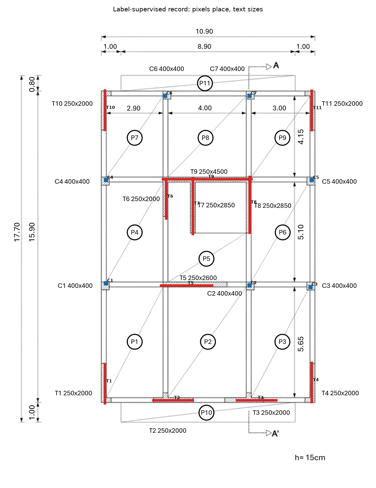
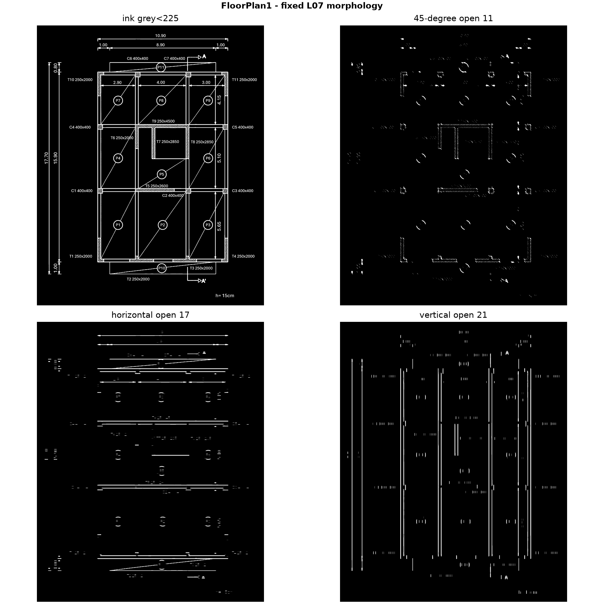
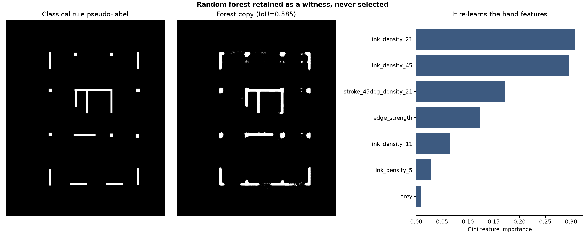
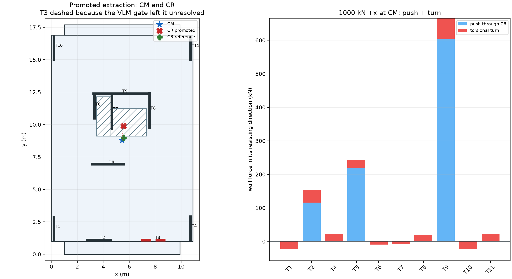
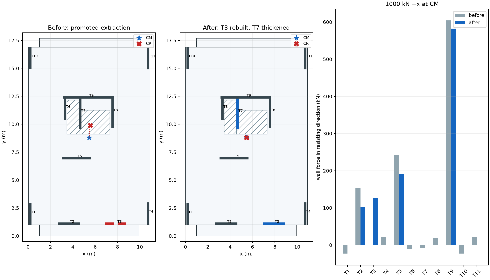
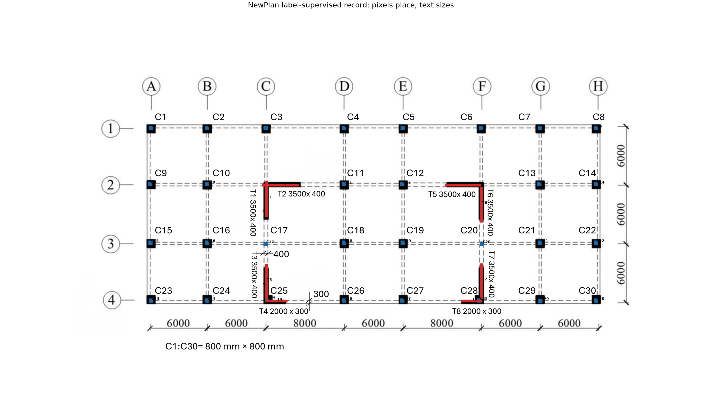
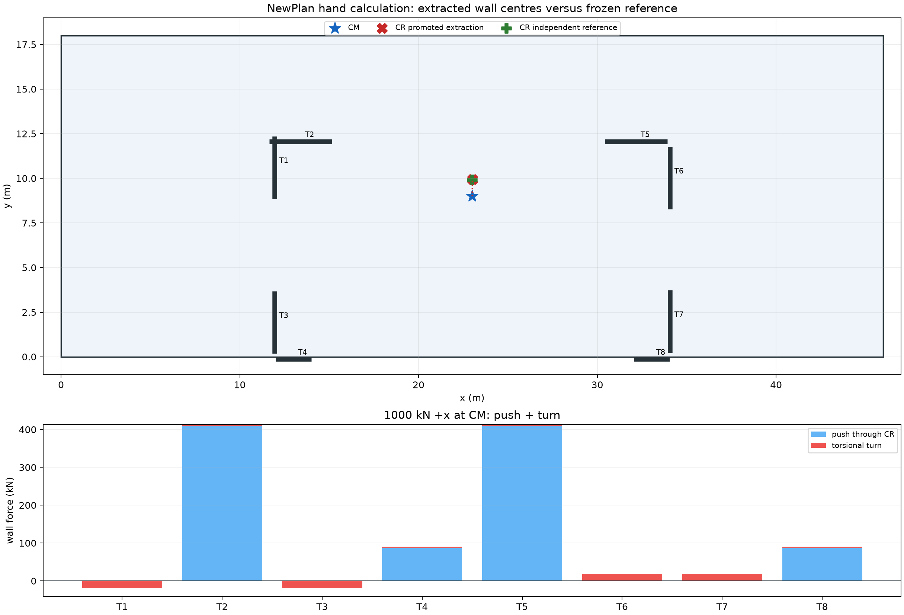
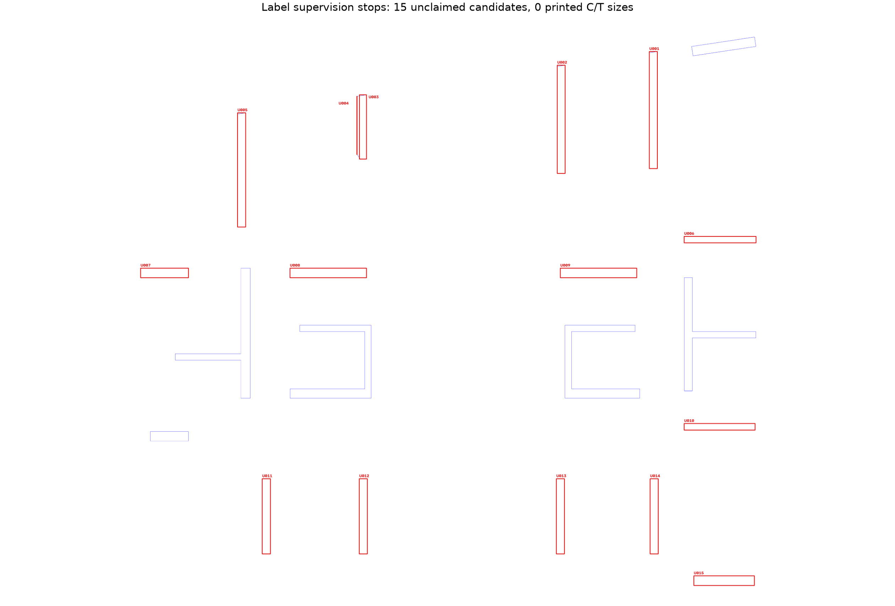
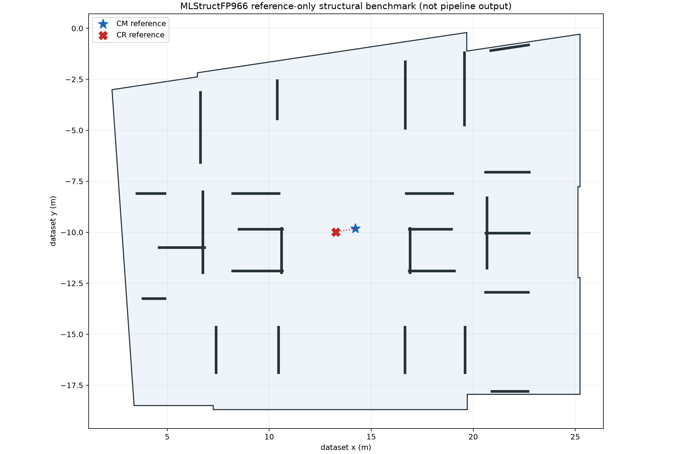

# Homework 3: Floor-Plan Reading and Rigid-Diaphragm Centre of Stiffness

**Course:** Computer (& AI) Methods for Structural Engineering (DISC 5203)<br>
**Student:** Shuhan He / 何抒翰<br>
**Student ID:** 21345221<br>
**Assigned input:** Floor Plan 1 (student-ID final digit = 1)<br>
**Prepared for review:** 7 November 2026<br>
**Repository:** one cumulative repository containing HW1, HW2 and HW3; this report is under `HW3/`

## 1. Executive summary

The assigned FloorPlan1 was read in the required order: fixed classical morphology, one printed label per element, a random forest retained but never selected, and two VLM readers restricted to four frozen flag crops. The immutable classical record contains **18 elements** (7 columns, 11 walls). LLaVA-OneVision resolved **3/4** flags and broke none; SmolVLM2 resolved **0/4**. LLaVA was promoted, but T3 remained unresolved and therefore excluded from the primary lateral model.

The primary hand result is **CM = (5.46045, 8.79152) m**, **CR = (5.54884, 9.89459) m**, and **e = 1.10660 m** with bending and shear. A 1000 kN +x load at CM therefore creates **1103.07 kN m** torque. The OpenSees `ElasticTimoshenkoBeam` rigid-diaphragm model agrees with the hand CR within **9.33e-10 m**. Rebuilding T3 at 309 mm and thickening T7 to 365 mm, without moving either centreline or the mass layout, reduces e to **0.000268 m** (99.9758%).

The locked pipeline generalized well to the course NewPlan: 38/38 elements, one flag, LLaVA 1/1, and e = 0.94594 m. It failed safely on public MLStructFP Floor 966: zero printed label-size strings meant zero auditable extracted elements, both VLMs resolved 0/15, and no structural record was promoted. A separate public-reference benchmark is reported as such; it is not presented as pipeline output.

## 2. Inputs, fixed assumptions and audit boundary

The original course files are hash-frozen in `config/input_manifest-HW3.json`. The main mechanics use E = 30 GPa, nu = 0.2, G = 12.5 GPa, storey height H = 3 m, shear factor 5/6, floor load 8.75 kN/m2 and five storeys. Units are kN and m.

The fixed reader is `grey < 225`, 11-px 45-degree opening, horizontal opening 17 px, vertical opening 21 px, and a 4:1 elongation rule. OCR is accepted only at confidence 0.85 and is run on both the original image and a long-line-removed copy. Pixels place an element; printed text sizes it. VLMs see only frozen local crops, never a whole plan, and cannot change coordinates.

The two local VLMs are [SmolVLM2-256M](https://huggingface.co/HuggingFaceTB/SmolVLM2-256M-Video-Instruct) revision `067788...` and [LLaVA-OneVision-Qwen2-0.5B](https://huggingface.co/llava-hf/llava-onevision-qwen2-0.5b-ov-hf) revision `74dd0b...`. Both use CPU float32, seed 21345221, greedy decoding and the same crop/question order per plan. An answer must be schema-valid, above 0.85, internally consistent and agree with a reference frozen before inference.

## 3. Task 1 - classical reading and label supervision on FloorPlan1

The classical pass keeps **399** connected components and **68** elongated candidates. Both OCR passes recover all 18 expected names. Label supervision claims exactly one compatible bar per label and closes the net tributary area at **180.1285 m2** and the five-storey axial sum at **7880.622 kN**. The measured growth scale is 126.019/125.000 px/m; the printed-frame scale is 130.826/130.629 px/m.





Four walls are frozen as flags before either VLM runs:

| Label | Flag | Expected printed size | Crop SHA-256 prefix |
|---|---|---|---|
| T3 | wall_in_pieces_along_axis+low_support_completion | 250x2000 | fd4c215dc5ec |
| T4 | low_support_completion | 250x2000 | 6b7ef25669c0 |
| T10 | low_support_completion | 250x2000 | 5d3beb62b245 |
| T11 | low_support_completion | 250x2000 | 05fb1b3ccb2c |

The complete immutable record is `output/FloorPlan1/results/record-classical-label-supervised-HW3.json`; model answers are applied only to a copy.

## 4. Kept-but-never-chosen random forests

All three forests use the same seven features, 80 trees, maximum depth 14, minimum leaf 3, balanced classes and seed 21345221. Training labels are copied from classical pseudo-labels, so the forests cannot independently correct classical errors and are never eligible for promotion.

| Plan | OOB | Test F1 | Rule-target IoU | Dominant evidence | Selected |
|---|---|---|---|---|---|
| FloorPlan1 | 0.982979 | 0.983485 | 0.584754 | 21/45-px ink density + 45-degree density | False |
| NewPlan | 0.971208 | 0.970087 | 0.557338 | 21/45-px ink density + 45-degree density | False |
| MLStructFP966 | 0.746687 | 0.674299 | 0.221414 | 45-px ink density (0.694) | False |



High held-out agreement does not guarantee full-plan fidelity: FloorPlan1 F1 is 0.9835 while full-ROI IoU is 0.5848. The public plan falls to F1 0.6743 and IoU 0.2214, visibly copying rejected composite outlines.

## 5. Tasks 1-2 - dual-VLM flag gate

The common response schema is `label`, `size_mm`, `continuous`, `confidence`, `reason`. A single outer JSON fence and quoted literal boolean/decimal may be normalized without changing values; prose, wrong keys, semantic contradictions and low confidence remain unresolved. The reference is a defensible independent reading, not asserted ground truth.

The frozen prompt form is:

```text
<one flag-specific question>
Inspect the crop, then return exactly one JSON object with exactly
label, size_mm, continuous, confidence, reason. Output JSON only.
```

For the no-text public plan, Prompt Revision 3 additionally identifies the U-number as an internal audit handle and `NOT_VISIBLE` as a nonnumeric missing-size sentinel. Both readers on a given plan receive byte-identical crops, questions and order.

| Plan | Model | Flags | Resolved | Broken | Unresolved | Mean confidence | Mean size error mm | Verdict |
|---|---|---|---|---|---|---|---|---|
| FloorPlan1 | smolvlm2-256m | 4 | 0 | 0 | 4 | n/a | n/a | witness |
| FloorPlan1 | llava-onevision-0.5b | 4 | 3 | 0 | 1 | 0.9 | 0.0 | llava-onevision-0.5b promoted |
| NewPlan | smolvlm2-256m | 1 | 0 | 0 | 1 | n/a | n/a | witness |
| NewPlan | llava-onevision-0.5b | 1 | 1 | 0 | 0 | 0.9 | 0.0 | llava-onevision-0.5b promoted |
| MLStructFP966 | smolvlm2-256m | 15 | 0 | 0 | 15 | n/a | n/a | witness |
| MLStructFP966 | llava-onevision-0.5b | 15 | 0 | 0 | 15 | n/a | n/a | witness |

On FloorPlan1, LLaVA reads all four labels/sizes and reports 0.9 confidence, but T3's field says continuous while its reason says not continuous; the contradiction guard leaves T3 unresolved. T4, T10 and T11 clear. SmolVLM2 produces no valid answer. Losing T3 changes the structural route: both actual VLM outputs place CR **0.91416 m** from the independent-reference CR. The chosen reader still wins the flag gate because it clears three audits without breaking one.

On NewPlan, LLaVA resolves T1 (1/1, 0 broken); SmolVLM2 resolves 0/1. Both structural states retain all eight walls because T1's classical continuity was already true and the flag concerned split OCR. On MLStructFP966, both readers resolve 0/15; a zero-resolved tie is archived and rejected, no reader is promoted, and no structural record exists.

The raw outputs remain separate files under each plan's `results/` directory; they are not pasted or repaired in this report.

## 6. Task 3 - hand CM, stiffness matrix, CR and eccentricity

For each continuous wall, I = tL3/12, Av = (5/6)tL and

`k = 1 / [H3/(3EI) + H/(G Av)]`.

The signed non-overlapping mass regions are:

| Region | Signed area m2 | cx m | cy m |
|---|---|---|---|
| main floor | 173.3100 | 5.450 | 8.950 |
| lower balcony | 8.9000 | 5.450 | 0.500 |
| upper balcony | 7.1200 | 5.450 | 17.300 |
| opening west | -3.3440 | 4.020 | 10.630 |
| opening east | -5.8575 | 5.945 | 10.175 |

They give net area **180.1285 m2**, CM **(5.460451, 8.791522) m**, mass **160.665 t per storey** and **803.325 t for five storeys**.

The primary bending-plus-shear matrix about CM is:

```text
K [kN/m, kN, kN m by DOF scaling]
[  3.628347e+06   0.000000e+00  -4.002309e+06 ]
[  0.000000e+00   4.053193e+06   3.582777e+05 ]
[ -4.002309e+06   3.582777e+05   1.124205e+08 ]

F = K^-1
[  2.870000e-07  -1.000000e-09   1.000000e-08 ]
[ -1.000000e-09   2.470000e-07  -1.000000e-09 ]
[  1.000000e-08  -1.000000e-09   9.000000e-09 ]
```

The flexibility and direct stiffness-weighted routes both give CR **(5.548845, 9.894589) m**, so e = **1.106603 m**. Omitting shear moves CR to **(5.609155, 10.798374) m** and raises e to **2.012353 m**; shear is therefore structurally material.

| Wall | Dir | x | y | L | t | Active | k shear | k bend | Push | Turn | Total kN |
|---|---|---|---|---|---|---|---|---|---|---|---|
| T1 | y | 0.1911 | 1.9454 | 2.0 | 0.25 | True | 420875.4 | 555555.6 | 0.00 | -23.04 | -23.04 |
| T2 | x | 3.6537 | 1.0995 | 2.0 | 0.25 | True | 420875.4 | 555555.6 | 116.00 | 37.82 | 153.81 |
| T3 | x | 7.9113 | 1.0995 | 2.0 | 0.25 | False | 420875.4 | 555555.6 | 0.00 | 0.00 | 0.00 |
| T4 | y | 10.7242 | 2.0067 | 2.0 | 0.25 | True | 420875.4 | 555555.6 | 0.00 | 22.25 | 22.25 |
| T5 | x | 4.3493 | 6.9558 | 2.6 | 0.25 | True | 792157.0 | 1220555.6 | 218.32 | 23.78 | 242.11 |
| T6 | y | 3.3097 | 11.3844 | 2.0 | 0.25 | True | 420875.4 | 555555.6 | 0.00 | -9.63 | -9.63 |
| T7 | y | 4.6627 | 11.0208 | 2.85 | 0.25 | True | 974407.9 | 1607578.1 | 0.00 | -8.82 | -8.82 |
| T8 | y | 7.5597 | 11.082 | 2.85 | 0.25 | True | 974407.9 | 1607578.1 | 0.00 | 20.02 | 20.02 |
| T9 | x | 5.3927 | 12.391 | 4.5 | 0.25 | True | 2415314.9 | 6328125.0 | 665.68 | -61.60 | 604.08 |
| T10 | y | 0.1911 | 15.9163 | 2.0 | 0.25 | True | 420875.4 | 555555.6 | 0.00 | -23.04 | -23.04 |
| T11 | y | 10.7242 | 15.901 | 2.0 | 0.25 | True | 420875.4 | 555555.6 | 0.00 | 22.25 | 22.25 |

For 1000 kN +x at CM, the decomposition is a push through CR plus **1103.067 kN m** torque. The saved rows close to 1000 kN in x, zero cross-wall force and the applied torque.



## 7. Tasks 4-5 - pertinent OpenSees rigid diaphragm and no-rotation point

The check model uses one 3D `ElasticTimoshenkoBeam` per continuous wall, strong-axis I = tL3/12 and Av = (5/6)tL. Weak-axis stiffness and St Venant torsion are 1e-9 of the strong idealization, matching the hand premise. Wall tops are tied to the CM master with `rigidDiaphragm(3, master, *wall_top_nodes)` and `Transformation` constraints. The implementation follows the official [ElasticTimoshenkoBeam](https://openseespydoc.readthedocs.io/en/latest/src/ElasticTimoshenkoBeam.html), [rigidDiaphragm](https://openseespydoc.readthedocs.io/en/latest/src/rigidDiaphragm.html), and [Transformation constraint](https://openseespydoc.readthedocs.io/en/latest/src/TransformationMethod.html) documentation.

Three unit loads at CM recover F and K. OpenSees 3.8.0 gives CR **(5.548845, 9.894589) m**, only **9.33e-10 m** from hand; maximum relative K difference is **9.23e-09**. A unit push through CR has saved rotation **-0.0 rad**. The 1000 kN case sums to **999.999999 kN** in x and **2.17e-08 kN** in cross-wall y. Push-plus-turn wall-force additivity residual is zero.

```text
OpenSees F at CM
[  2.868770e-07  -9.030000e-10   1.021600e-08 ]
[ -9.030000e-10   2.467910e-07  -8.190000e-10 ]
[  1.021600e-08  -8.190000e-10   9.261000e-09 ]

OpenSees K = F^-1
[  3.628347e+06  -6.400000e-11  -4.002309e+06 ]
[ -2.700000e-11   4.053193e+06   3.582777e+05 ]
[ -4.002309e+06   3.582777e+05   1.124205e+08 ]
```

## 8. Task 6 - modify the wall system so CM and CR coincide

The slab, openings, columns, grid and every wall centreline remain fixed. T3 is rebuilt continuous at **309 mm** thickness and T7 is thickened from 250 to **365 mm** at the shaft edge. These values separately target yCR and xCR and are rounded only after solving the required stiffness.

| Quantity | Before | After |
|---|---|---|
| CR x m | 5.548845 | 5.460607 |
| CR y m | 9.894589 | 8.791740 |
| Eccentricity m | 1.106603 | 0.000268 |
| 1000 kN torque kN m | 1103.067 | 0.218 |
| Peak absolute wall force kN | 604.080 | 582.194 |
| Ttheta / Tx | 1.1068 | 1.0266 |

Eccentricity falls **99.9758%**. Modified OpenSees agrees with hand CR within **1.55e-09 m**, retains zero rotation through CR and closes the 1000 kN load.



## 9. Task 7 - why CM = CR matters

Before modification, e = 1.10660 m creates 1103.07 kN m torque under the fixed 1000 kN push. The torsional radius is `r_t = sqrt(29.758) = 5.455 m`; using the dimensionally consistent force amplification `1 + e d_r / r_t^2`, T2 is the most torsion-amplified wall at **1.3260 times** its no-turn push share. The largest absolute wall force falls from 604.08 to 582.19 kN after the two stiffness changes. The characteristic period ratio Ttheta/Tx falls from 1.1068 to 1.0266. Before modification the first coupled mode is 68.98% torsional; after CM/CR decoupling it is nearly pure torsion rather than mixed translation-torsion. Coincidence removes modal coupling, not necessarily torsion-mode ordering set by mass and stiffness.

CM = CR removes accidental torque for one uniform floor under a uniform lateral action. It does not remove torsion caused by height-varying mass/stiffness, nonuniform ground motion, nonlinear cracking, uncertainty, or higher modes. It also does not excuse extraction error: leaving T3 unresolved moves the VLM-based CR 0.914 m from the independent-reference route.

## 10. Task 8A - locked pipeline on course NewPlan

NewPlan uses the unchanged FloorPlan1 parameters. It recovers **38/38** names (30 columns, 8 walls), with T1 reconstructed from split OCR and frozen as the only flag. Tributary area closes at 828.0 m2 and the five-storey axial sum at 36,225 kN.



LLaVA resolves T1 at 0.9 confidence; Smol resolves none. All coordinates remain classical. The rectangular slab gives CM = (23.0, 9.0) m. The promoted extraction gives CR **(23.007450, 9.945907) m**, e = **0.945937 m**. The frozen manual reference gives CR **(23.000000, 9.918072) m**; the 28.8 mm difference is caused by extracted wall-centre offsets, not VLM geometry.



## 11. Task 8B - public MLStructFP Floor 966

The found plan is public [MLStructFP](https://github.com/MLSTRUCT/MLStructFP) test Floor 966, associated with the [Automation in Construction article](https://doi.org/10.1016/j.autcon.2023.105132) and retained under its MIT license. It differs materially from FloorPlan1: 9600x6784 transparent blue-line CAD, irregular slab, 20 wall groups/28 rectangles, one 8.5-degree wall, and zero printed C/T size strings. A public Pleasanton wood shear-wall sheet was considered and rejected because its nailing schedule would change the material/size premise rather than test the same method.

The fixed morphology keeps 20 components and 15 elongated candidates. OCR produces no accepted label; consequently label supervision claims **zero elements**. Post-run audit hits 14/28 unique frozen rectangles (50% recall) and splits one wall edge twice. This is reported as a safe failure, not repaired with annotation IDs.



Both VLMs resolve 0/15 and no reader passes the at-least-one-resolved gate. `NOT_VISIBLE` is not a wall size, so no promoted structural record is created. For comparison only, the independent public annotation gives reference CM **(14.220398, -9.818857) m**, reference CR **(13.266821, -9.988242) m**, e = **0.968504 m** using all 28 frozen rectangles. These numbers are explicitly reference-only, not pipeline output.



## 12. Cross-plan generalisation verdict

| Plan | Classical claimed elements | Flags | Best VLM | Pipeline CM m | Pipeline CR m | e m | Verdict |
|---|---|---|---|---|---|---|---|
| FloorPlan1 | 18 | 4 | LLaVA 3/4 | (5.4605, 8.7915) | (5.5488, 9.8946) | 1.1066 | accepted main pipeline |
| NewPlan | 38 | 1 | LLaVA 1/1 | (23.0000, 9.0000) | (23.0075, 9.9459) | 0.9459 | accepted without parameter retuning |
| MLStructFP966 | 0 | 15 | none 0/15 | unavailable | unavailable | unavailable | safe failure; reference benchmark separate |

What generalized: the frozen morphology and coordinate extraction locate simple isolated bars, the forest remains reproducible, crop hashes enforce identical evidence, the VLM gate prevents silent repair, and the structural calculation closes when numeric wall geometry exists. What did not: the one-label/one-element premise fails on a dataset image with no printed size strings; 4:1 components miss composite walls; the small VLMs do not reliably follow the no-text audit schema. The correct response is no promoted record, not annotation leakage.

## 13. Reproducibility, Git iterations and limitations

From the cumulative repository root:

```powershell
Set-Location HW3
python -m pip install -r requirements-HW3.txt
python scripts/run_classical_pipeline.py
python scripts/train_random_forest.py
python scripts/run_dual_vlm_flags.py --score-only
python scripts/run_hand_structural.py
powershell -File scripts/run_opensees_py312.ps1
python scripts/run_modified_structural.py
python scripts/prepare_task8_references.py
python scripts/run_newplan_classical.py
python scripts/train_newplan_random_forest.py
python scripts/run_newplan_dual_vlm_flags.py --score-only
python scripts/run_newplan_hand_structural.py
python scripts/run_mlstruct_classical.py
python scripts/train_mlstruct_random_forest.py
python scripts/run_mlstruct_dual_vlm_flags.py --score-only
python scripts/run_mlstruct_reference_structural.py
python scripts/build_hw3_report.py
python scripts/render_hw3_report_pdf.py
python scripts/verify_hw3_outputs.py
```

Real VLM generation commands omit `--score-only`; raw outputs are already committed and are not redownloaded for routine verification. OpenSees uses the isolated Python 3.12 target declared in `requirements-opensees-py312-HW3.txt` because the Windows extension ABI does not match the main Python 3.11 environment.

The detailed decision and failure history is `briefings/iteration_log-HW3.md`. Git commits are deliberately stage-sized: inputs, classical record, each forest, each VLM gate, hand calculation, OpenSees check, modification, each holdout plan and the final report. No random forest was selected, no VLM saw a whole plan or moved a coordinate, and no failed public-plan extraction was back-filled.

Limitations: OCR and morphology remain resolution/style sensitive; the hand and OpenSees models are linear, elastic, uncracked and single-storey; wall rectangles are idealised strong-axis elements; diaphragm flexibility, soil-structure interaction, cracking and vertical irregularity are excluded. The public-reference benchmark depends on dataset annotation quality and is called a defensible reference, not truth.

## 14. Deliverable index

- Markdown report: `report/21345221-report-HW3.md`;
- PDF: `output/pdf/21345221-report-HW3.pdf`;
- immutable/promotion records, flags, VLM outputs and score sheets: `output/<plan>/results/`;
- retained forests: `models/random-forest-*-HW3.joblib`;
- main hand/OpenSees results and force tables: `output/FloorPlan1/results/`;
- figures 01-19: `output/<plan>/figures/`;
- scripts and exact requirements: `scripts/`, `requirements-HW3.txt`, `requirements-opensees-py312-HW3.txt`;
- complete iteration log: `briefings/iteration_log-HW3.md`.
